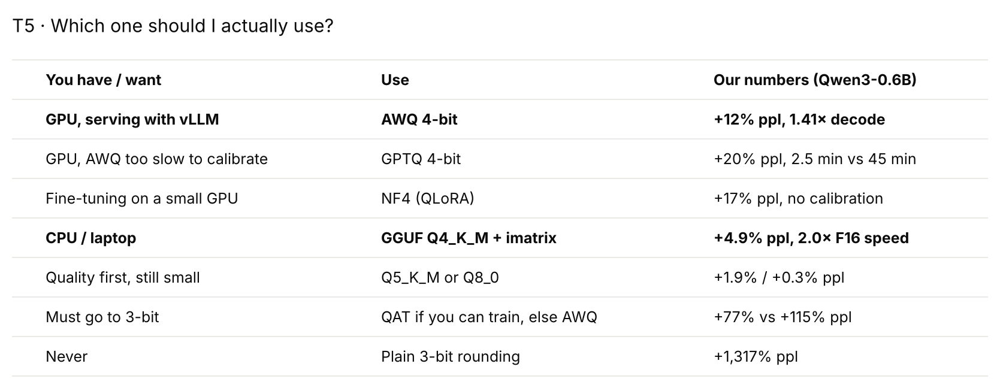
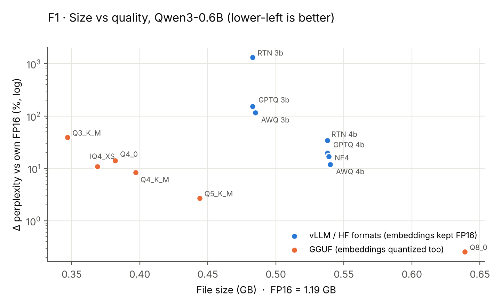
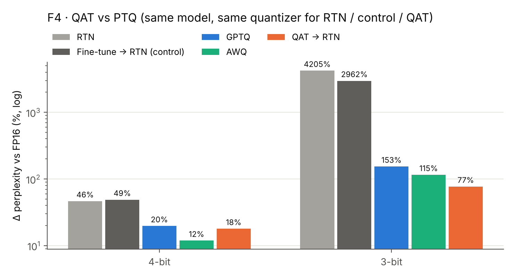
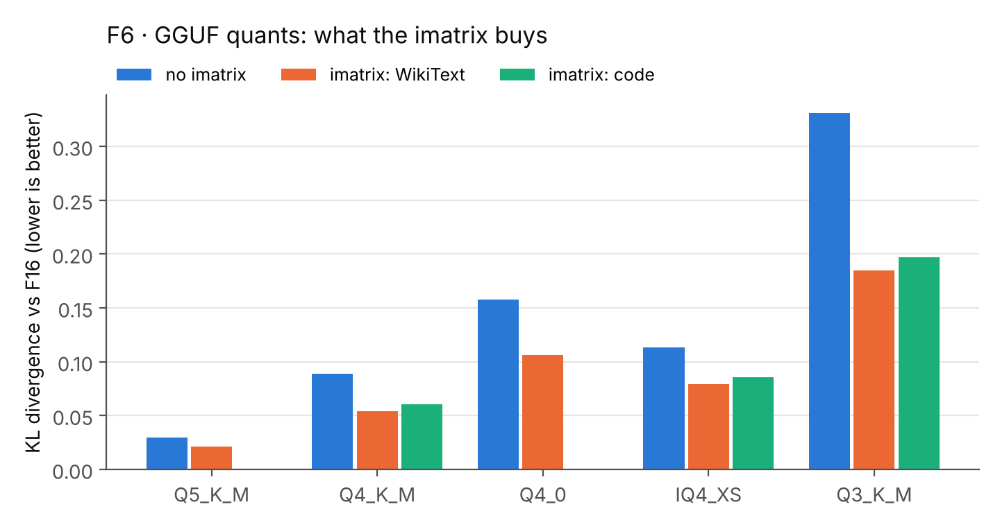
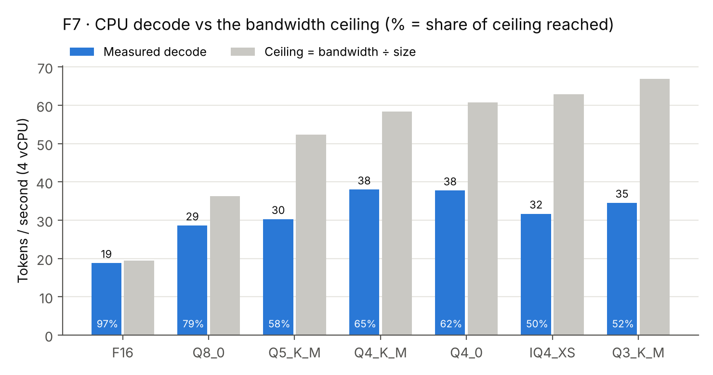

# EdgeLayer · Quantization benchmark on free hardware

Every method from the [EdgeLayer](https://edgelayer.substack.com) quantization series, measured on **one small model**
(Qwen3-0.6B base) with **free GPUs only** (Colab / Kaggle T4) and a 4-vCPU CPU.

> Companion code for the post *"Which one should I actually use? Every method from this series, measured"* (`LINK-BLOG-8`).

## Which one should I actually use?



| | |
|---|---|
|  |  |
|  |  |

All tables (`.md`, `.csv`, `.png`) are in [`tables/`](tables), all figures in [`figures/`](figures).

## What's here

```
notebooks/
  01_ptq_nf4_t4_speed.ipynb       FP16 · RTN · GPTQ · AWQ · NF4 (4 and 3 bit), calibration shift, T4 speed (vLLM)
  02_gguf_imatrix_cpu_speed.ipynb GGUF quants ± imatrix (llama.cpp): KL divergence, perplexity, CPU speed vs bandwidth
  03_qat_vs_ptq.ipynb             QAT vs PTQ vs a fine-tune-only control, recovery curve, % of weights that changed tick
edgelayer_bench.py                shared helpers: one eval protocol, quantizers, fake quant + STE, speed runs, logging
make_assets.py                    rebuilds every figure and table from results/
results/                          raw results (one JSON row per config) from our runs
figures/  tables/                 generated by make_assets.py
```

## How to run

1. Open a notebook in **Colab** (Runtime → T4 GPU) or **Kaggle** (Accelerator: GPU T4 x2, Internet: on).
2. In the setup cell, set `PLATFORM = "colab"` or `"kaggle"`, and replace `<your-username>` in `REPO_RAW`
   (the notebook downloads `edgelayer_bench.py` from this repo; from a local clone it uses the file directly).
3. **Run all.** Every finished config is saved to `results_*.jsonl` immediately. After a disconnect, re-run all cells:
   finished configs are skipped.
4. The last cell prints the results file, in case the download fails.
5. Rebuild the figures and tables: `python make_assets.py` (needs `pandas`, `matplotlib`, `tabulate`).

| Notebook | Rough time on a free T4 | Notes |
|---|---|---|
| 01 | ~3–4 h | AWQ calibration runs in fp32 (fp16 gives NaN on a T4): ~45 min per config |
| 02 | ~1.5–3 h | If the llama.cpp CUDA build fails, quality runs fall back to CPU automatically |
| 03 | ~5 h | Three training runs of ~90 min (600 steps × 8 × 1,024 tokens) |

## Eval protocol (every row)

| Metric | How |
|---|---|
| Perplexity | WikiText-2 test, ctx 2,048 (full set on the HF path; ~41k-token subset on the llama.cpp CPU path) + held-out code docs |
| KL divergence | vs FP16, per token, plus top-1 agreement |
| Tasks | arc_easy + hellaswag, 0-shot, 1,000 examples each (±~1.6 pts) |
| Speed | vLLM batch 1, 512 in / 128 out, median of 5 · llama-bench 512/128, 5 reps |
| Calibration | 128 × 2,048 tokens of C4 (code set for the shift test) · imatrix 200 × 512 tokens |

HF and llama.cpp rows are compared as **Δ% vs each tool's own FP16**, not by absolute perplexity.

## Caveats

- One small model: gaps are larger than the 7B+ numbers in the papers.
- Task scores are noisy; GPTQ and NF4 scoring above FP16 is noise. Perplexity and KL divergence carry the comparison.
- Whole-file bits/weight (~7.2 for 4-bit HF files) includes FP16 embeddings; GGUF quantizes embeddings too.
- QAT's training data (C4) shifts the model slightly (+5% WikiText ppl for the FP16 fine-tune).
- Not run: QLoRA, FP8, MXFP4/NVFP4, AWQ calibrated on code (out of memory on a free T4), NF4 speed (recent vLLM
  no longer serves bitsandbytes checkpoints), GGUF speed on GPU.

## Environment of our runs

T4 16 GB (Colab and Kaggle) · Intel Xeon @ 2.00 GHz, 4 vCPU · transformers 5.20–5.21 · llm-compressor 0.15.0 ·
compressed-tensors 0.20.1 · bitsandbytes 0.50.2 · lm-eval 0.4.13 · torch 2.11–2.14 · vLLM (latest, own venv) ·
llama.cpp `3549c27` · seed 0. Every result row also stores its own environment.

## License

- **Code** (`*.py`, `notebooks/`): [MIT](LICENSE).
- **Results, figures and tables** (`results/`, `figures/`, `tables/`): [CC BY 4.0](LICENSE-DATA.md).

Model: [Qwen/Qwen3-0.6B-Base](https://huggingface.co/Qwen/Qwen3-0.6B-Base) (Apache 2.0).
